<!--
  Every image on this page is a hand-written, animated SVG.
  Edit scripts/build.py, then run:  python scripts/build.py
  assets/activity.svg is rebuilt nightly by .github/workflows/activity.yml
-->

<a href="https://mehanth.vercel.app"></a>

 

<picture>
  <source media="(prefers-color-scheme: light)" srcset="assets/headers/about-light.svg"/>
  
</picture>


  

<picture>
  <source media="(prefers-color-scheme: light)" srcset="assets/headers/work-light.svg"/>
  
</picture>

  <a href="https://github.com/Itz-mehanth/Tamil-HTML-CSS"></a>
  <a href="https://github.com/Itz-mehanth/GH9B"></a>
  <a href="https://github.com/Itz-mehanth/CrownOfSovereigns"></a>
  <a href="https://github.com/Itz-mehanth/Aura-AI-Agent"></a>
  <a href="https://github.com/Itz-mehanth/4kwallpaper.ai"></a>
  <a href="https://github.com/Itz-mehanth/ARDrive"></a>
  <a href="https://github.com/Itz-mehanth/Retempla"></a>
  <a href="https://github.com/Itz-mehanth/NPM-Package---R3F-Nav-Controls"></a>

<picture>
  <source media="(prefers-color-scheme: light)" srcset="assets/headers/stack-light.svg"/>
  
</picture>


  

<picture>
  <source media="(prefers-color-scheme: light)" srcset="assets/headers/activity-light.svg"/>
  
</picture>


<picture>
  <source media="(prefers-color-scheme: dark)" srcset="https://raw.githubusercontent.com/Itz-mehanth/Itz-mehanth/output/github-snake-dark.svg"/>
  
</picture>

  

<picture>
  <source media="(prefers-color-scheme: light)" srcset="assets/headers/connect-light.svg"/>
  
</picture>

  <a href="https://mehanth.vercel.app"></a>
  <a href="https://www.linkedin.com/in/mehanth-776892279"></a>
  <a href="mailto:mehanth362@gmail.com"></a>
  <a href="https://instagram.com/itz_mehanth"></a>

