<!--
  Every image on this page is an animated SVG with embedded fonts, in a dark and a light version.
  Edit scripts/build.py, then run:  python scripts/build.py
  assets/*/activity.svg is rebuilt nightly by .github/workflows/activity.yml
-->

<a href="https://mehanth.vercel.app"><picture><source media="(prefers-color-scheme: light)" srcset="assets/light/hero.svg"/></picture></a>

  

<picture><source media="(prefers-color-scheme: light)" srcset="assets/light/headers/about.svg"/></picture>

<picture><source media="(prefers-color-scheme: light)" srcset="assets/light/terminal.svg"/></picture>

  

<picture><source media="(prefers-color-scheme: light)" srcset="assets/light/headers/work.svg"/></picture>

  <a href="https://github.com/Itz-mehanth/Tamil-HTML-CSS"><picture><source media="(prefers-color-scheme: light)" srcset="assets/light/cards/bharat-html.svg"/></picture></a>
  <a href="https://github.com/Itz-mehanth/GH9B"><picture><source media="(prefers-color-scheme: light)" srcset="assets/light/cards/gh9b.svg"/></picture></a>
  <a href="https://github.com/Itz-mehanth/CrownOfSovereigns"><picture><source media="(prefers-color-scheme: light)" srcset="assets/light/cards/crown.svg"/></picture></a>
  <a href="https://github.com/Itz-mehanth/Aura-AI-Agent"><picture><source media="(prefers-color-scheme: light)" srcset="assets/light/cards/aura.svg"/></picture></a>
  <a href="https://github.com/Itz-mehanth/4kwallpaper.ai"><picture><source media="(prefers-color-scheme: light)" srcset="assets/light/cards/4kwallpaper.svg"/></picture></a>
  <a href="https://github.com/Itz-mehanth/ARDrive"><picture><source media="(prefers-color-scheme: light)" srcset="assets/light/cards/ardrive.svg"/></picture></a>
  <a href="https://github.com/Itz-mehanth/Retempla"><picture><source media="(prefers-color-scheme: light)" srcset="assets/light/cards/retempla.svg"/></picture></a>
  <a href="https://github.com/Itz-mehanth/NPM-Package---R3F-Nav-Controls"><picture><source media="(prefers-color-scheme: light)" srcset="assets/light/cards/r3f-nav.svg"/></picture></a>

 

<picture><source media="(prefers-color-scheme: light)" srcset="assets/light/headers/stack.svg"/></picture>

<picture><source media="(prefers-color-scheme: light)" srcset="assets/light/stack.svg"/></picture>

 

<picture><source media="(prefers-color-scheme: light)" srcset="assets/light/headers/activity.svg"/></picture>

<picture><source media="(prefers-color-scheme: light)" srcset="assets/light/activity.svg"/></picture>

<picture><source media="(prefers-color-scheme: light)" srcset="https://raw.githubusercontent.com/Itz-mehanth/Itz-mehanth/output/github-snake.svg"/></picture>

  

<picture><source media="(prefers-color-scheme: light)" srcset="assets/light/headers/connect.svg"/></picture>

  <a href="https://mehanth.vercel.app"><picture><source media="(prefers-color-scheme: light)" srcset="assets/light/links/portfolio.svg"/>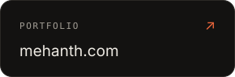</picture></a>
  <a href="https://www.linkedin.com/in/mehanth-776892279"><picture><source media="(prefers-color-scheme: light)" srcset="assets/light/links/linkedin.svg"/>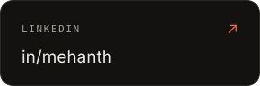</picture></a>
  <a href="mailto:mehanth362@gmail.com"><picture><source media="(prefers-color-scheme: light)" srcset="assets/light/links/email.svg"/>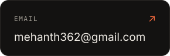</picture></a>
  <a href="https://instagram.com/itz_mehanth"><picture><source media="(prefers-color-scheme: light)" srcset="assets/light/links/instagram.svg"/>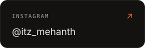</picture></a>

 

<picture><source media="(prefers-color-scheme: light)" srcset="assets/light/footer.svg"/></picture>
