<!--
  Every image on this page is an animated SVG with embedded fonts, in a dark and a light version.
  Generated by scripts/build.py (this README too). Edit the data there, then run:  python scripts/build.py
  assets/*/activity.svg is rebuilt nightly by .github/workflows/activity.yml
-->

<a href="https://mehanth.com"><picture><source media="(prefers-color-scheme: light)" srcset="assets/light/hero.svg"/></picture></a>

<picture><source media="(prefers-color-scheme: light)" srcset="assets/light/highlights.svg"/></picture>

  

<picture><source media="(prefers-color-scheme: light)" srcset="assets/light/headers/experience.svg"/></picture>

<picture><source media="(prefers-color-scheme: light)" srcset="assets/light/experience.svg"/></picture>

  

<picture><source media="(prefers-color-scheme: light)" srcset="assets/light/headers/work.svg"/></picture>

  <a href="https://vrroom.netlify.app"><picture><source media="(prefers-color-scheme: light)" srcset="assets/light/cards/herbal-garden.svg"/></picture></a>
  <a href="https://github.com/Itz-mehanth/LiveStock"><picture><source media="(prefers-color-scheme: light)" srcset="assets/light/cards/stock-pipeline.svg"/></picture></a>
  <a href="https://marketplace.visualstudio.com/publishers/Mehanth"><picture><source media="(prefers-color-scheme: light)" srcset="assets/light/cards/vscode.svg"/></picture></a>
  <a href="https://github.com/Itz-mehanth/Retempla"><picture><source media="(prefers-color-scheme: light)" srcset="assets/light/cards/retempla.svg"/></picture></a>
  <a href="https://github.com/Itz-mehanth/MedPlant"><picture><source media="(prefers-color-scheme: light)" srcset="assets/light/cards/medplant.svg"/></picture></a>
  <a href="https://github.com/Itz-mehanth/GH9B"><picture><source media="(prefers-color-scheme: light)" srcset="assets/light/cards/gh9b.svg"/></picture></a>

 

<picture><source media="(prefers-color-scheme: light)" srcset="assets/light/headers/about.svg"/></picture>

<picture><source media="(prefers-color-scheme: light)" srcset="assets/light/terminal.svg"/></picture>

  

<picture><source media="(prefers-color-scheme: light)" srcset="assets/light/headers/stack.svg"/></picture>

<picture><source media="(prefers-color-scheme: light)" srcset="assets/light/stack.svg"/></picture>

 

<picture><source media="(prefers-color-scheme: light)" srcset="assets/light/headers/activity.svg"/></picture>

<picture><source media="(prefers-color-scheme: light)" srcset="assets/light/activity.svg"/></picture>

<picture><source media="(prefers-color-scheme: light)" srcset="https://raw.githubusercontent.com/Itz-mehanth/Itz-mehanth/output/github-snake.svg"/></picture>

  

<picture><source media="(prefers-color-scheme: light)" srcset="assets/light/headers/connect.svg"/></picture>

  <a href="https://mehanth.com"><picture><source media="(prefers-color-scheme: light)" srcset="assets/light/links/portfolio.svg"/></picture></a>
  <a href="https://www.linkedin.com/in/mehanth-776892279"><picture><source media="(prefers-color-scheme: light)" srcset="assets/light/links/linkedin.svg"/></picture></a>
  <a href="mailto:mehanth362@gmail.com"><picture><source media="(prefers-color-scheme: light)" srcset="assets/light/links/email.svg"/></picture></a>
  <a href="https://instagram.com/itz_mehanth"><picture><source media="(prefers-color-scheme: light)" srcset="assets/light/links/instagram.svg"/></picture></a>

 

<picture><source media="(prefers-color-scheme: light)" srcset="assets/light/footer.svg"/></picture>
